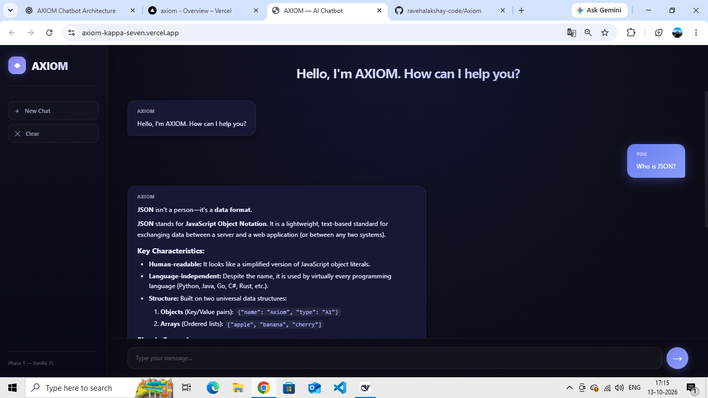

# AXIOM — AI Chatbot



A modern, responsive AI chatbot powered by NVIDIA Nemotron 3 Ultra. Features streaming markdown responses, a dark premium theme, mobile-first responsive layout, and full-stack FastAPI + vanilla JS architecture.

## Project Structure

```
Axiom/
├── Frontend/
│   ├── index.html
│   ├── index.css
│   └── app.js
├── Backend/
│   ├── main.py
│   └── requirements.txt
├── Homepage.png
└── vercel.json
```

## Features

- Streaming AI responses with safe Markdown rendering
- Fully responsive on mobile, tablet, and desktop
- Custom query reply for "Does God exist?"
- No arbitrary response length limits (4096 tokens, model max)
- Sidebar navigation with New Chat and Clear actions

## Deployment

- **Backend (Render):** `https://axiom-90ie.onrender.com`
- **Frontend (Vercel):** Served from `Frontend/` folder

## Quick Start

```bash
# Backend
pip install -r Backend/requirements.txt
cd Backend && uvicorn main:app --reload

# Frontend
# Open Frontend/index.html or deploy via Vercel
```

## Environment

Set the environment variable for the NVIDIA API:
```
NVIDIA_API_KEY=your_key_here
```

> Note: If `.venv` paths are broken, recreate the virtual environment or use `pip install -r Backend/requirements.txt` directly.
